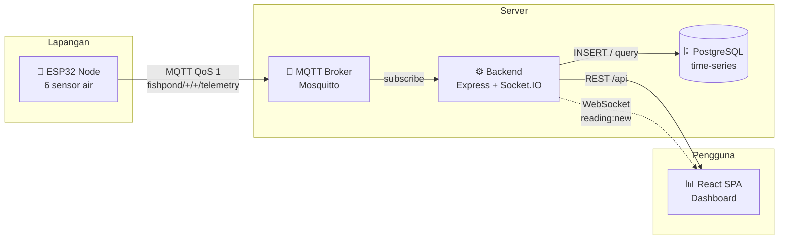

<div align="center">

# 🐟 Smart Fish Pond IoT

**Sistem monitoring kualitas air kolam ikan berbasis IoT — realtime, end-to-end.**

Node ESP32 membaca 6 parameter kualitas air, mengirim telemetri via MQTT,
lalu backend Node.js menyimpannya ke PostgreSQL dan menyiarkannya
ke dashboard React secara realtime.

[](https://github.com/glacie21/smartfishpond/actions/workflows/ci.yml)
[](LICENSE)
[](https://nodejs.org)
[](https://platformio.org)
[](https://react.dev)
[](https://www.postgresql.org)

[Arsitektur](docs/architecture.md) ·
[Hardware](docs/hardware.md) ·
[Topik MQTT](docs/mqtt-topics.md) ·
[REST API](docs/api.md) ·
[Operasional](docs/operations.md)

</div>

---

## 📋 Daftar Isi

- [Arsitektur](#-arsitektur)
- [Fitur](#-fitur)
- [Parameter yang Dipantau](#-parameter-yang-dipantau)
- [Teknologi](#-teknologi)
- [Cara Menjalankan](#-cara-menjalankan)
- [Struktur Repository](#-struktur-repository)
- [Dokumentasi](#-dokumentasi)
- [Lisensi](#-lisensi)

---

## 🏗 Arsitektur



Telemetri masuk sekali, dipakai dua kali: disimpan ke PostgreSQL untuk histori,
sekaligus di-broadcast ke seluruh klien yang sedang membuka kolam tersebut —
tanpa polling.

---

## ✨ Fitur

- 📈 **Monitoring realtime** — 6 parameter kualitas air, update tanpa refresh
- 📡 **MQTT QoS 1 + Last Will** — status device online/offline otomatis terdeteksi
- 🗄 **Time-series di PostgreSQL** — plus agregasi per jam/hari untuk grafik rentang panjang
- 🚨 **Alert & notifikasi Telegram** — ambang batas per kolam, debounce + hysteresis, alert device offline
- 🎛️ **Kendali aktuator** — aerator, pompa, dan feeder dari dashboard, dengan konfirmasi device & auto-off
- 🔌 **Auto-registrasi** — kolam & device terbentuk sendiri saat telemetri pertama masuk; kelola lewat dashboard
- 💾 **Buffer offline di firmware** — data tidak hilang saat koneksi terputus
- 📶 **Update firmware via WiFi (OTA)** — tanpa membongkar box di kolam
- 🔐 **Aman secara default** — login JWT dengan peran admin/viewer, rate limit, broker MQTT berpassword + ACL per device
- 🧪 **Simulator device** — bisa dicoba penuh tanpa hardware sama sekali
- 🐳 **Docker Compose** — seluruh stack jalan dengan satu perintah
- 🚀 **Siap produksi** — HTTPS otomatis (Caddy), backup database terjadwal, metrik Prometheus
- ✅ **CI otomatis** — lint, test backend (unit + integrasi PostgreSQL), test frontend, test & kompilasi firmware

---

## 🌡 Parameter yang Dipantau

| Parameter | Sensor | Satuan | Pin ESP32 |
| --- | --- | --- | --- |
| 🌡️ Suhu air | DS18B20 (waterproof) | °C | GPIO 4 |
| ⚗️ pH | PH-4502C | 0–14 | GPIO 34 |
| 🧂 TDS | Gravity SEN0244 | ppm | GPIO 35 |
| 💨 Oksigen terlarut (DO) | Gravity SEN0237 | mg/L | GPIO 32 |
| 🌫️ Kekeruhan | SEN0189 | NTU | GPIO 33 |
| 📏 Level air | JSN-SR04T / HC-SR04 | cm | GPIO 5 & 18 |

> [!NOTE]
> Metrik bernilai `null` itu normal — satu sensor gagal dibaca tidak membatalkan
> paket telemetri lainnya. Wiring lengkap ada di [docs/hardware.md](docs/hardware.md).

---

## 🧰 Teknologi

| Lapisan | Stack |
| --- | --- |
| **Firmware** | ESP32 · PlatformIO · C++/Arduino |
| **Broker** | Eclipse Mosquitto (MQTT + WebSocket) |
| **Backend** | Node.js 20 · Express · Socket.IO · `mqtt` · `pg` · Zod · Helmet |
| **Database** | PostgreSQL |
| **Frontend** | React 18 · Vite · React Router · Recharts · socket.io-client |
| **DevOps** | Docker Compose · GitHub Actions · npm workspaces |

---

## 🚀 Cara Menjalankan

### Prasyarat

| Kebutuhan | Versi | Untuk |
| --- | --- | --- |
| Node.js & npm | `>= 20` / `>= 9` | backend + frontend (npm workspaces) |
| Docker & Docker Compose | terbaru | PostgreSQL + Mosquitto |
| PlatformIO | terbaru | firmware ESP32 (opsional) |

### 1️⃣ Infrastruktur & dependensi

```bash
git clone https://github.com/glacie21/smartfishpond.git
cd smartfishpond

cp .env.example .env                                         # isi password MQTT & JWT_SECRET
cp docker/mosquitto/credentials.example docker/mosquitto/credentials   # akun MQTT per device
docker compose up -d postgres mosquitto

npm install            # memasang dependensi backend + frontend sekaligus
```

> [!NOTE]
> Broker MQTT **menolak koneksi anonim**. Akun backend dan simulator dibuat dari
> `MQTT_BACKEND_PASSWORD` / `MQTT_SIMULATOR_PASSWORD` di `.env`, sedangkan akun
> tiap ESP32 dari `docker/mosquitto/credentials`. Detailnya di
> [docs/mqtt-topics.md](docs/mqtt-topics.md#keamanan).

### 2️⃣ Backend

```bash
cp backend/.env.example backend/.env   # MQTT_PASSWORD = MQTT_BACKEND_PASSWORD di .env root
npm run migrate        # membuat tabel
npm run user:create -- admin --role admin   # akun login dashboard (password ditanyakan)
npm run dev:backend    # http://localhost:4000
```

Peran akun: `admin` boleh menambah/mengubah/menghapus kolam, `viewer` hanya
melihat dashboard. Perintah yang sama dipakai untuk mengganti password.

### 3️⃣ Frontend

```bash
cp frontend/.env.example frontend/.env
npm run dev:frontend   # http://localhost:5173
```

### 4️⃣ Coba tanpa hardware

```bash
npm run seed           # riwayat 7 hari untuk 2 kolam contoh
npm run simulate       # node virtual yang terus mengirim telemetri
```

Buka `http://localhost:5173`, login dengan akun dari langkah 2 — grafik langsung
terisi dan terus bergerak.

<details>
<summary><b>🔧 5️⃣ Flash firmware ke ESP32</b></summary>

<br>

```bash
cd firmware
cp include/secrets.example.h include/secrets.h   # isi WiFi, broker, password MQTT device
pio run -t upload
pio device monitor
```

> [!IMPORTANT]
> Kalibrasi sensor (pH, TDS, DO) **wajib** dilakukan sebelum data dianggap valid.
> Langkah-langkahnya ada di [docs/hardware.md](docs/hardware.md).

</details>

<details>
<summary><b>🐳 Menjalankan seluruh stack dengan Docker</b></summary>

<br>

```bash
docker compose --profile full up -d --build
docker compose exec backend node src/cli/createUser.js admin --role admin
```

Mode ini berjalan dengan `NODE_ENV=production`, sehingga `JWT_SECRET` di `.env`
wajib diisi (minimal 32 karakter). Tanpa itu, backend menolak start.

| Layanan | Alamat |
| --- | --- |
| Dashboard | `http://localhost:5173` |
| REST API | `http://localhost:4000/api` |
| Health check | `http://localhost:4000/api/health` |
| MQTT broker | `mqtt://localhost:1883` (WebSocket `9001`) |

Untuk server sungguhan (domain + HTTPS, backup otomatis, monitoring), pakai
`docker-compose.prod.yml` — langkahnya di [docs/operations.md](docs/operations.md).

</details>

### 📜 Skrip npm

| Perintah | Fungsi |
| --- | --- |
| `npm run dev:backend` | Backend mode development |
| `npm run dev:frontend` | Dashboard mode development |
| `npm run build` | Build produksi frontend |
| `npm run migrate` | Jalankan migrasi database |
| `npm run user:create -- <username> --role admin\|viewer` | Buat akun dashboard / ganti password |
| `npm run seed` | Isi data contoh 7 hari |
| `npm run simulate` | Jalankan device virtual |
| `npm run lint` | ESLint backend + frontend |
| `npm test` | Unit test backend + frontend |
| `npm run test:integration` | Test integrasi backend (butuh `TEST_DATABASE_URL`, database dikosongkan) |
| `npm run backup` / `npm run restore -- <file>` | Backup / pulihkan database |

---

## 📂 Struktur Repository

<details>
<summary>Klik untuk melihat pohon direktori</summary>

<br>

```
smartfishpond_IoT/
├── firmware/          # Firmware ESP32 (PlatformIO, C++/Arduino)
│   ├── include/       # Header: konfigurasi, deklarasi modul
│   ├── src/           # Implementasi: main loop, sensor, wifi, mqtt, aktuator, OTA
│   ├── lib/PondMath/  # Rumus sensor murni (diuji di host)
│   ├── test/          # Unit test Unity (pio test -e native)
│   └── platformio.ini
├── backend/           # REST API + MQTT ingest (Node.js, Express)
│   ├── src/
│   │   ├── config/        # Konfigurasi terpusat dari env
│   │   ├── db/            # Pool koneksi + migrasi SQL
│   │   ├── mqtt/          # Client MQTT & handler pesan telemetri
│   │   ├── repositories/  # Query database
│   │   ├── services/      # Logika bisnis
│   │   ├── controllers/   # Handler HTTP
│   │   ├── routes/        # Definisi endpoint
│   │   ├── realtime/      # Socket.IO broadcast
│   │   ├── middleware/    # Auth, rate limit, error handler, validasi, logging
│   │   ├── observability/ # Metrik Prometheus
│   │   └── cli/           # Perintah admin (buat user)
│   └── tests/             # Unit test + integration/ (PostgreSQL)
├── frontend/          # Dashboard web (React + Vite)
│   └── src/
│       ├── api/           # HTTP client
│       ├── components/    # Komponen UI
│       ├── context/       # Sesi login
│       ├── hooks/         # Custom hooks (data, realtime, alert)
│       └── pages/         # Halaman (+ test *.test.jsx di samping file)
├── docs/              # Dokumentasi arsitektur, hardware, API, topik MQTT
├── scripts/           # Simulator device, seed data, backup & restore
├── docker/            # Konfigurasi Mosquitto (ACL, entrypoint kredensial)
├── deploy/            # Caddyfile & skrip backup untuk produksi
├── .github/workflows/ # CI: lint, test, kompilasi firmware, validasi compose
├── docker-compose.yml # PostgreSQL + Mosquitto + backend + frontend
├── docker-compose.prod.yml # Override produksi: Caddy, backup, port internal
└── package.json       # npm workspaces (backend + frontend)
```

</details>

---

## 📚 Dokumentasi

| Dokumen | Isi |
| --- | --- |
| [🏛 Arsitektur sistem](docs/architecture.md) | Alur data, keputusan desain, skema database |
| [🔌 Wiring & hardware](docs/hardware.md) | Daftar komponen, pinout, kalibrasi sensor |
| [📡 Topik & payload MQTT](docs/mqtt-topics.md) | Format topik, skema telemetri & status |
| [🌐 Referensi REST API](docs/api.md) | Endpoint, query param, event Socket.IO |
| [🚀 Operasional](docs/operations.md) | Deploy produksi, backup & restore, monitoring, rotasi kredensial |
| [🤝 Berkontribusi](CONTRIBUTING.md) | Alur kerja, pemeriksaan sebelum PR, konvensi kode |
| [📝 Changelog](CHANGELOG.md) | Riwayat perubahan & langkah migrasi |

---

## 📄 Lisensi

Dirilis di bawah lisensi [MIT](LICENSE).

<div align="center">
<sub>Dibuat untuk budidaya ikan yang lebih terukur 🐟</sub>
</div>
